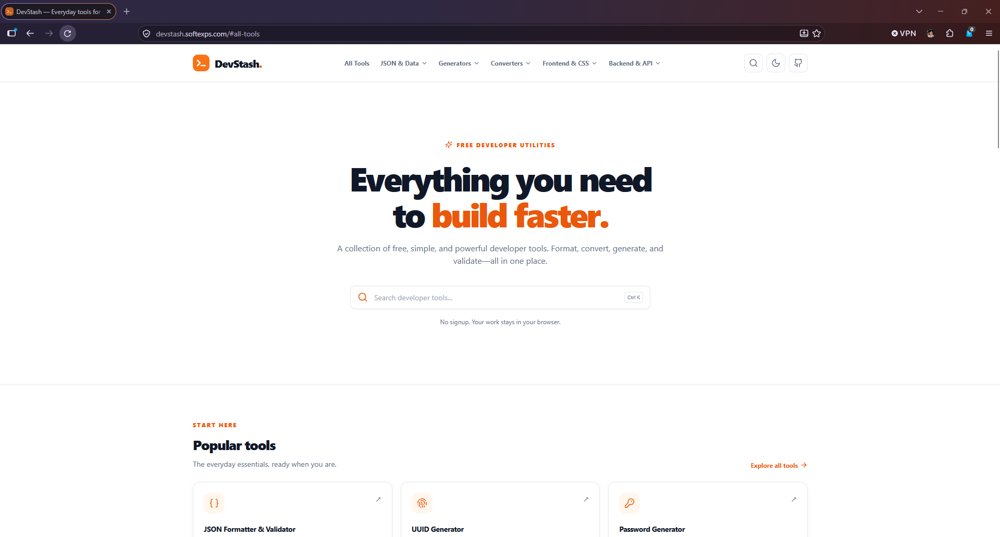
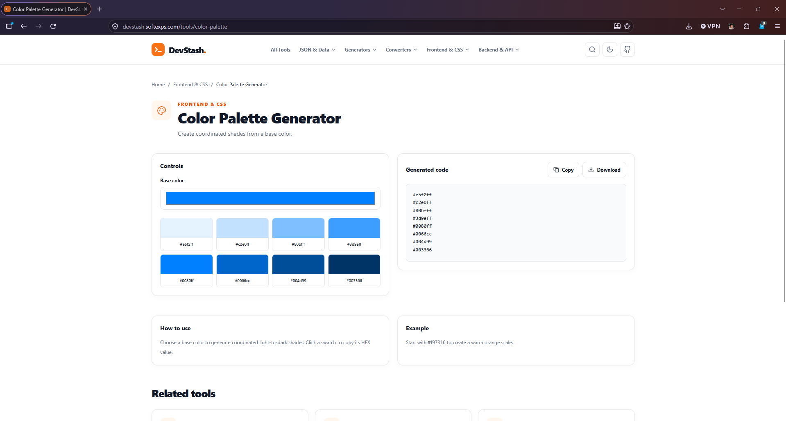
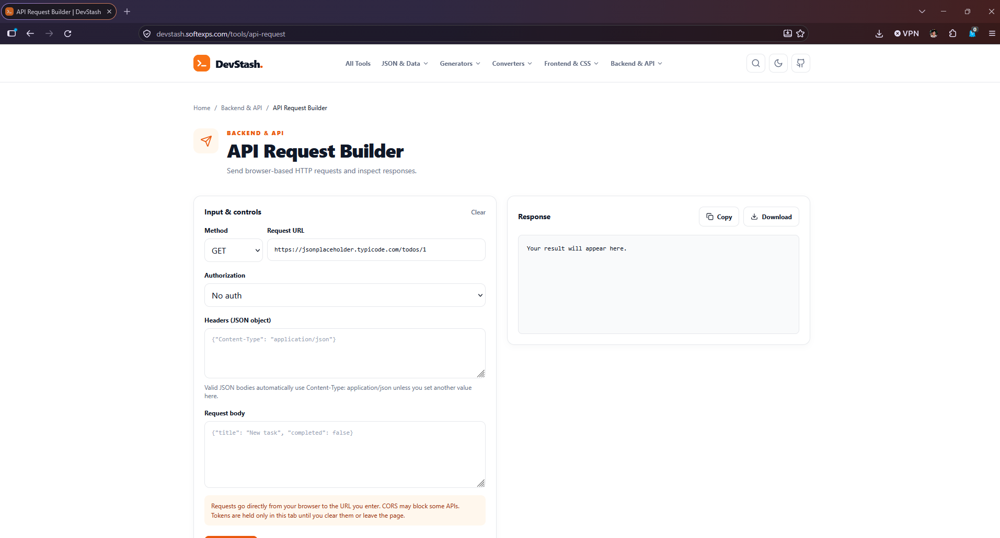
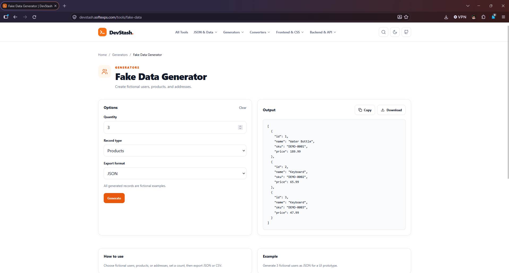
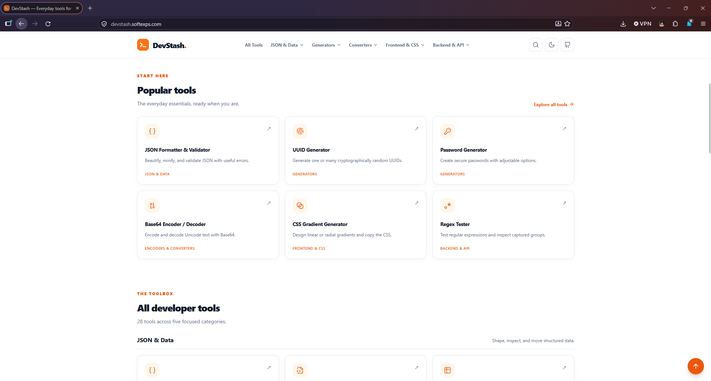

# DevStash.

**Everyday tools for developers.**

A collection of free, practical, browser-based developer utilities. Format, convert, generate, validate, and build faster—all in one place.

---
Live Website

Explore DevStash → https://devstash.softexps.com/

## Preview

## About DevStash

DevStash is a growing collection of essential developer utilities designed to simplify everyday development tasks.

Instead of switching between multiple websites, developers can access useful tools in one clean, organized platform.

Whether you're formatting JSON, generating UUIDs, testing regular expressions, or creating CSS styles, DevStash helps you work faster and more efficiently.

**No signup. No unnecessary setup. Just tools that work.**

## Features

- **Developer Utilities** — Practical tools for common development tasks.
- **Instant Results** — Format, convert, validate, and generate directly in your browser.
- **Easy Navigation** — Find tools using categorized navigation menus.
- **Global Search** — Quickly discover tools using search and keyboard shortcuts.
- **Copy & Download** — Easily reuse generated results.
- **Responsive Design** — Accessible on desktop, tablet, and mobile devices.
- **Dark Mode** — Comfortable viewing in light and dark themes.
- **Privacy-Focused** — Most utilities process data locally in your browser.

## Developer Tools

### JSON & Data

- JSON Formatter & Validator
- JSON to TypeScript
- JSON to CSV
- JSON Diff Checker
- CSV to JSON

### Generators

- UUID Generator
- Password Generator
- Lorem Ipsum Generator
- Slug Generator
- Fake Data Generator
- Hash Generator

### Encoders & Converters

- Base64 Encoder / Decoder
- URL Encoder / Decoder
- JWT Decoder
- Unix Timestamp Converter
- HTML Entity Converter
- Color Converter

### Frontend & CSS

- CSS Gradient Generator
- Box Shadow Generator
- Border Radius Generator
- Color Palette Generator
- CSS Grid Generator
- SVG Optimizer

### Backend & API

- Regex Tester
- Cron Expression Generator
- HTTP Status Code Reference
- SQL Formatter
- API Request Builder

> Tool availability and features may change as DevStash continues to evolve.

## How to Use

1. Open the DevStash website.
2. Browse developer tools using the top navigation bar.
3. Select the tool you need.
4. Enter your input or adjust the available settings.
5. Generate, format, convert, or validate your data.
6. Copy or download the result for your project.

No account registration is required.

## Built With

DevStash is developed using:

- **Nuxt 4** — Vue-based application framework
- **Vue 3** — Reactive user interfaces
- **TypeScript** — Type-safe development
- **Tailwind CSS** — Utility-first styling
- **Lucide Icons** — Consistent iconography

## Privacy & Security

DevStash is designed with privacy in mind.

Most utilities process data locally in your browser without uploading it to DevStash servers.

Some tools, such as the API Request Builder, intentionally send requests to external endpoints specified by the user.

Avoid entering sensitive credentials into tools unless you understand how they process your data.

## Repository Information

This public repository contains DevStash documentation, screenshots, announcements, and project information.

The application's source code is maintained in a separate private repository.

## Feedback & Suggestions

Found a bug or have an idea for a new developer tool?

Feel free to open a GitHub Issue to report problems, request features, or share suggestions.

Community feedback is always welcome.

## License

See the [LICENSE](LICENSE) file for the licensing terms applicable to this repository.

---

**DevStash — Everyday tools for developers.**

*Build faster. Work smarter.*